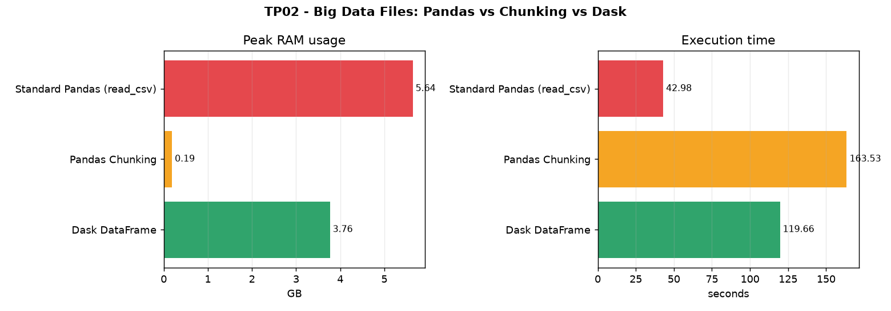
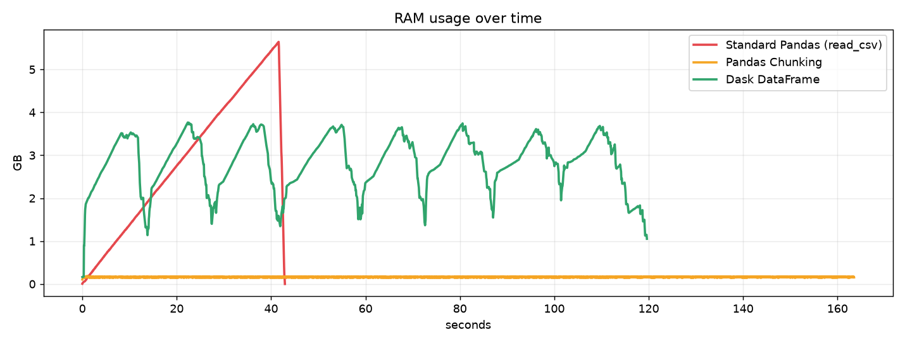

# TP02 — How to Work with Big Data Files (+5GB)

**Module:** Big Data Analytics — Master 2 IA & Data Science — 2026/2027
**University of Eloued** — Faculty of Exact Sciences — Computer Science Dept.

Read a **5 GB+ file** three ways and compare them:

1. **standard Pandas `read_csv()`** → runs out of memory (OOM),
2. **Pandas chunking** → stream the file with constant memory,
3. **Dask DataFrame** → parallel + lazy computing.

---

## Contents

```
TP2_big_data_files/
├── generate_dataset.py     # creates the 6 GB CSV (data/sales_big.csv)
├── tp02.py                 # the 3 tasks + report + charts
├── requirements.txt        # pandas dask[complete] psutil matplotlib pyarrow
├── report/                 # generated report (results + images)
│   ├── report.html
│   ├── benchmark.png
│   ├── memory_timeline.png
│   ├── results.csv
│   └── results.json
└── data/                   # the big CSV (NOT committed - see below)
```

## Dataset

A generated **sales** CSV with mixed types (numeric + strings):

| | |
|---|---|
| File | `data/sales_big.csv` |
| Size | **6.02 GB** |
| Rows | **75,000,000** |
| Columns | `order_id, order_date, customer_id, product, category, region, payment_method, quantity, unit_price, total_amount` |

**Why generated:** a real 5 GB+ **CSV** is not practical to download here
(available sources run at ~0.5–1.9 MB/s → 1–5 hours, and the fast ones are
Parquet, which breaks the `pd.read_csv()` task). Generating is instant,
reproducible (seeded), and gives the exact size and schema needed.

```bash
python generate_dataset.py            # ~6 GB (default)
python generate_dataset.py --gb 8     # ~8 GB
```

---

## Setup & run

```bash
pip install -r requirements.txt
python generate_dataset.py --gb 6
python tp02.py
```

`tp02.py` runs the three tasks and writes the report into `report/`.

---

## The three tasks

| # | Task | Function | What happens |
|---|------|----------|--------------|
| 1 | **The Traditional Failure (OOM)** | `task1_oom()` | `pd.read_csv()` loads the *whole* file into RAM and crashes with `MemoryError` |
| 2 | **Stream Processing (Chunking)** | `task2_chunking()` | reads the file in chunks of **100,000 rows** and accumulates `sum` / `mean` incrementally |
| 3 | **Parallel Out-of-Core (Dask)** | `task3_dask()` | `dask.dataframe.read_csv` builds a **lazy** graph; `.compute()` runs it in parallel |

Extra pieces: `MemoryMonitor` (samples RAM over time with `psutil`) and
`build_report()` (draws the charts with `matplotlib`).

### About Task 1 on a big-RAM machine
This machine has 32 GB RAM + an automatic page file, so a naive `read_csv()`
would eventually finish (very slowly) instead of crashing. To reproduce the
real-world failure **deterministically**, Task 1 runs the read in a subprocess
whose memory is capped with a **Windows Job Object** (`TASK1_MEMORY_LIMIT_GB = 6`).
When the process passes the cap, the allocation fails → `MemoryError`.

### Lazy Evaluation (Task 3)
`dd.read_csv()` only builds a **graph** (100 partitions, 200 tasks) — no data
is read. Nothing executes until `.compute()` is called. The `sum()` and
`count()` are then computed in **one shared graph** (the file is read once),
in parallel over the partitions.

---

## Results

| Method | Status | Peak RAM | Execution time |
|--------|--------|---------:|---------------:|
| Standard Pandas (`read_csv`) | **MemoryError (OOM)** | 5.64 GB | 43.0 s |
| Pandas Chunking | OK (constant memory) | **0.19 GB** | 163.5 s |
| Dask DataFrame | OK (parallel) | 3.76 GB | **119.7 s** |

*(all three computed the same metrics: `sum(total_amount) = 516,607,678,312.78`,
`mean(unit_price) = 1252.4186`.)*

### Peak RAM vs execution time



### RAM usage over time



**How to read it:** the red line (standard Pandas) climbs straight to the
memory cap and dies; the orange line (chunking) stays flat near zero; the green
line (Dask) rises and falls as partitions are processed in parallel — lower peak
than Pandas and faster than chunking.

---

## GitHub note

**The 6 GB dataset is NOT uploaded.** GitHub rejects files over **100 MB**
(free Git LFS is only 1 GB), so `data/` is in `.gitignore`. Only the scripts,
the README and the small `report/` files are committed. To get the data, run
`python generate_dataset.py --gb 6`.
