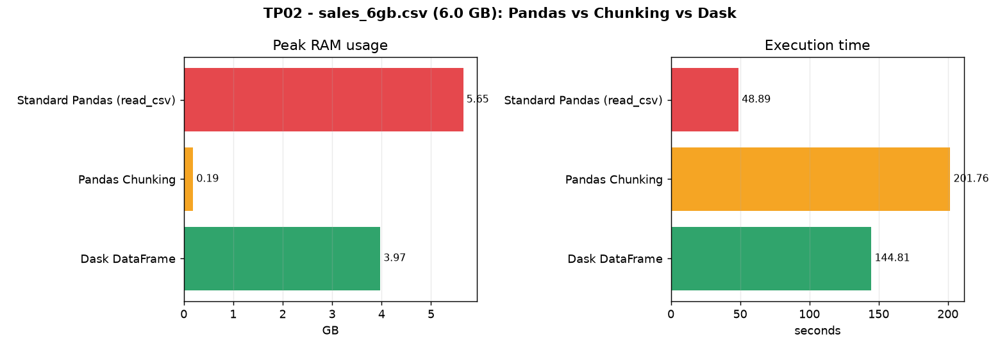
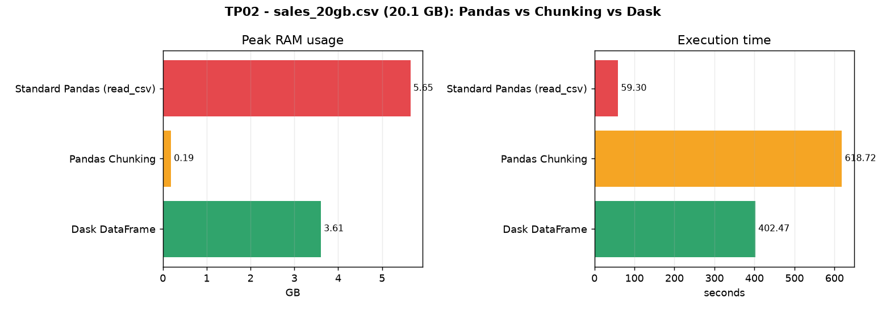
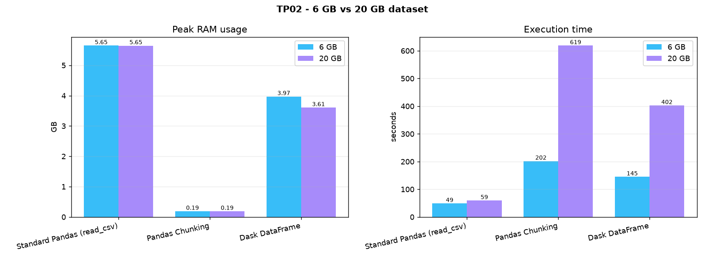

# TP02 — How to Work with Big Data Files (+5GB)

**Module:** Big Data Analytics — Master 2 IA & Data Science — 2026/2027
**University of Eloued** — Faculty of Exact Sciences — Computer Science Dept.

Read a **5 GB+ file** three ways and compare them, on **two dataset sizes
(6 GB and 20 GB)**:

1. **standard Pandas `read_csv()`** → runs out of memory (OOM),
2. **Pandas chunking** → stream the file with constant memory,
3. **Dask DataFrame** → parallel + lazy computing.

---

## Contents

```
TP2_big_data_files/
├── generate_dataset.py     # creates the CSVs (data/*.csv)
├── tp02.py                 # the 3 tasks + report + charts
├── compare.py              # 6 GB vs 20 GB comparison
├── requirements.txt        # pandas dask[complete] psutil matplotlib pyarrow
├── report/
│   ├── comparison.png      # 6 GB vs 20 GB
│   ├── comparison.html
│   ├── 6gb/                # benchmark.png, memory_timeline.png, report.html, results.*
│   └── 20gb/
└── data/                   # the big CSVs (NOT committed - see below)
```

## Datasets

Generated **sales** CSVs with mixed types (numeric + strings):

| File | Size | Rows |
|------|-----:|-----:|
| `data/sales_6gb.csv` | 6.02 GB | 75,000,000 |
| `data/sales_20gb.csv` | 20.07 GB | 248,000,000 |

Columns: `order_id, order_date, customer_id, product, category, region,
payment_method, quantity, unit_price, total_amount`.

**Why generated:** a real 5 GB+ **CSV** is not practical to download here
(available sources run at ~0.5–1.9 MB/s → 1–5 hours, and the fast ones are
Parquet, which breaks the `pd.read_csv()` task). Generating is instant,
reproducible (seeded), and gives the exact size and schema needed.

```bash
python generate_dataset.py --gb 6  --name sales_6gb.csv
python generate_dataset.py --gb 20 --name sales_20gb.csv
```

---

## Setup & run

```bash
pip install -r requirements.txt
python generate_dataset.py --gb 6 --name sales_6gb.csv

python tp02.py --data data/sales_6gb.csv  --report report/6gb
python tp02.py --data data/sales_20gb.csv --report report/20gb
python compare.py
```

To compare several pandas chunk sizes in one run, pass them after
`--chunk-sizes`:

```bash
python tp02.py --data data/sales_6gb.csv --report report/chunk-comparison `
  --chunk-sizes 1000 100000 1000000 10000000
```

On Windows PowerShell, the backtick continues the command onto the next
line; the command can also be entered on one line. The run executes Task 1
once, each requested chunking benchmark once, and Dask once. A separate
`Pandas Chunking (...)` row is written for every requested size. The
`10,000,000`-row option is valid, but it uses considerably more RAM because
one chunk is held in memory at a time. The final chunk may contain fewer
rows when the dataset size is not an exact multiple of the chunk size.

---

## The three tasks

| # | Task | Function | What happens |
|---|------|----------|--------------|
| 1 | **The Traditional Failure (OOM)** | `task1_oom()` | `pd.read_csv()` loads the *whole* file into RAM and crashes with `MemoryError` |
| 2 | **Stream Processing (Chunking)** | `task2_chunking(chunk_size)` | reads the file in the requested number of rows (default **100,000**) and accumulates `sum` / `mean` incrementally |
| 3 | **Parallel Out-of-Core (Dask)** | `task3_dask()` | `dask.dataframe.read_csv` builds a **lazy** graph; `.compute()` runs it in parallel |

Extra pieces: `MemoryMonitor` (samples RAM over time with `psutil`),
`build_report()` (charts with `matplotlib`) and `compare.py`.

### About Task 1 on a big-RAM machine
This machine has 32 GB RAM + an automatic page file, so a naive `read_csv()`
would eventually finish (very slowly) instead of crashing. To reproduce the
real-world failure **deterministically**, Task 1 runs the read in a subprocess
whose memory is capped with a **Windows Job Object** (`TASK1_MEMORY_LIMIT_GB = 6`).
When the process passes the cap, the allocation fails → `MemoryError`.

---

## Results — 6 GB

| Method | Status | Peak RAM | Execution time |
|--------|--------|---------:|---------------:|
| Standard Pandas (`read_csv`) | **MemoryError (OOM)** | 5.65 GB | 48.9 s |
| Pandas Chunking | OK (constant memory) | **0.19 GB** | 201.8 s |
| Dask DataFrame | OK (parallel) | 3.97 GB | **144.8 s** |



## Results — 20 GB

| Method | Status | Peak RAM | Execution time |
|--------|--------|---------:|---------------:|
| Standard Pandas (`read_csv`) | **MemoryError (OOM)** | 5.65 GB | 59.3 s |
| Pandas Chunking | OK (constant memory) | **0.19 GB** | 618.7 s |
| Dask DataFrame | OK (parallel) | 3.61 GB | **402.5 s** |



## 6 GB vs 20 GB

| Method | Peak 6 GB | Peak 20 GB | Time 6 GB | Time 20 GB | Time ×|
|--------|----------:|-----------:|----------:|-----------:|------:|
| Standard Pandas | 5.65 GB | 5.65 GB | 48.9 s | 59.3 s | ×1.21 |
| Pandas Chunking | 0.19 GB | 0.19 GB | 201.8 s | 618.7 s | ×3.07 |
| Dask DataFrame | 3.97 GB | 3.61 GB | 144.8 s | 402.5 s | ×2.78 |



### What the numbers show
* **RAM stays constant while the data grows ×3.3** — chunking 0.19 GB and Dask
  ~3.6–4 GB are the same for 6 GB and 20 GB. Only **time** grows with the size.
* **Standard Pandas always dies** (OOM) no matter the size — the failure is
  about loading everything at once, not about the file size.
* **Dask is faster than chunking** (≈1.4× here) because it uses several threads
  and an optimized graph, while chunking is sequential.
* Both safe methods computed **identical results** on each dataset
  (e.g. 20 GB: `sum(total_amount) = 1,708,391,574,126.21`).

---

## GitHub note

**The datasets are NOT uploaded.** GitHub rejects files over **100 MB**
(free Git LFS is only 1 GB), so `data/` is in `.gitignore`. Only the scripts,
the README and the small `report/` files are committed. To get the data, run
`generate_dataset.py`.

---

# TP04: Docker deployment

## Self-contained dataset image

The `with-data` image packages the Python analysis and
`data/sales_6gb.csv` together. The CSV is 6,463,485,112 bytes.
The Dockerfile copies it to `/app/data/sales_6gb.csv`.
No local dataset mount is needed when using this image.

The earlier published `1.0` tag contains code only. It is not the dataset image.
The new tag must finish building and pushing before other machines can pull it.

## Docker files

- `Dockerfile` installs dependencies and copies the analysis code and CSV.
- `.dockerignore` includes only the Dockerfile, requirements, analysis script,
  and this one CSV. Other datasets and reports stay outside the build context.
- `compose.yaml` uses `amaranecib/sales-bigdata-tp04:with-data`.
  Only the report output is mounted from the host.
- `Dockerfile.dataset` reuses the published `1.0` application environment.
  Its own ignore file transfers only the compressed CSV and analysis script.
  A build-time bind mount decompresses the CSV into the final image without
  retaining an extra compressed-file layer.

`--skip-oom` avoids the Windows-specific full-file memory-limit experiment.

## Task 1: Check Docker

Run PowerShell in this folder with Docker Desktop running:

```powershell
docker --version
docker compose version
docker info
```

## Task 2: Build, push, and pull

The publisher needs the local CSV to build. Anyone pulling the finished image
does not need a separate copy. Keep the dataset out of GitHub's normal Git history.

```powershell
docker build -t amaranecib/sales-bigdata-tp04:with-data .
docker login -u amaranecib
docker push amaranecib/sales-bigdata-tp04:with-data
docker pull amaranecib/sales-bigdata-tp04:with-data
```

For a smaller build transfer, prepare a gzip copy and use the alternate
Dockerfile. The final image still contains the original uncompressed CSV:

```powershell
python -c "import gzip,shutil; src=open('data/sales_6gb.csv','rb'); dst=gzip.open('data/sales_6gb.csv.gz','wb',compresslevel=1); shutil.copyfileobj(src,dst,length=8*1024*1024); dst.close(); src.close()"
docker build -f Dockerfile.dataset -t amaranecib/sales-bigdata-tp04:with-data .
```

Verify the embedded file without any host data mount:

```powershell
docker run --rm --entrypoint python amaranecib/sales-bigdata-tp04:with-data -c "from pathlib import Path; p=Path('/app/data/sales_6gb.csv'); print(p, p.stat().st_size); assert p.stat().st_size == 6463485112"
```

## Task 3: Three containers on a network

These are temporary networking demonstrations, not distributed analysis workers.
Each sees the embedded CSV from the same image. Docker shares image layers
between these containers; it does not need three separate image downloads.
The batch program does not listen on a port, so these commands do not publish one.

Use an unused network and unused container names. The earlier demo may still
occupy `tp04-node1` through `tp04-node3`, so these use different names.

```powershell
docker network create tp04-data-network
$image = "amaranecib/sales-bigdata-tp04:with-data"
docker run -d --name tp04-data-node1 --network tp04-data-network --entrypoint python $image -c "import time; print('node1 ready', flush=True); time.sleep(3600)"
docker run -d --name tp04-data-node2 --network tp04-data-network --entrypoint python $image -c "import time; print('node2 ready', flush=True); time.sleep(3600)"
docker run -d --name tp04-data-node3 --network tp04-data-network --entrypoint python $image -c "import time; print('node3 ready', flush=True); time.sleep(3600)"
docker ps
docker network inspect tp04-data-network
```

## Task 4: Run with Docker Compose

To use Docker Hub without rebuilding or requiring a local CSV:

```powershell
docker compose pull
docker compose up --no-build
docker compose ps -a
docker compose down
```

To follow the PDF's build command on the publisher's machine instead, run
`docker compose up --build`. Building requires the local CSV.
Do not add a mount over `/app/data`: it would hide the embedded dataset.

The report appears under `docker-report/`. A successful analysis exits with
code 0. Existing reports and verification files from the earlier code-only image
are historical evidence, not proof that the new dataset tag has been pushed.

## Task 5: Report

### What is Docker, and why is it useful in data-science projects?

Docker builds an image with an application and its runtime dependencies, then
runs that image in an isolated container. For data-science work, this keeps the
Python environment consistent across machines and makes an analysis easier to
share and repeat.

### What is the difference between an image and a container?

An image is the built template. A container is a running or stopped instance
created from that image. Multiple containers can use the same image.

### What do `FROM`, `WORKDIR`, `COPY`, `RUN`, and `CMD` do?

- `FROM` chooses the base image and Python runtime.
- `WORKDIR` sets the directory for later build and run commands.
- `COPY` adds files from the build context to the image.
- `RUN` executes commands during the image build. Here it installs Python packages.
- `CMD` provides the default arguments when a container starts. The `ENTRYPOINT`
  in this Dockerfile starts the analysis script.

### What problem does Docker Compose solve?

Compose describes services, volumes, networks, and settings in one YAML file.
It can build and start the project with one command and stop it with another.

### How does `docker run` compare with `docker compose up`?

`docker run` starts one container using options on the command line.
`docker compose up` reads `compose.yaml` and starts the services declared there.

### How could this Compose project add a database?

Add a database service such as PostgreSQL with a persistent named volume. Put it
on the same Compose network as the analysis service, then connect using the
database service name as the host. Keep passwords in environment variables or a
local `.env` file, not in the Docker image.

## Screenshots

Save screenshots of the Docker version, image push and pull, three running
containers, and the Compose run under `screenshots/` before submitting this
folder to GitHub.

