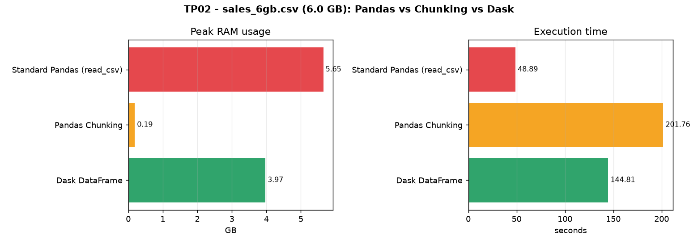
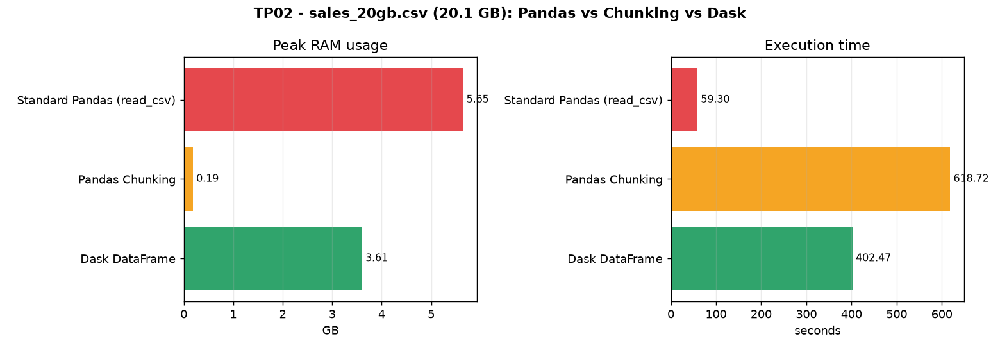
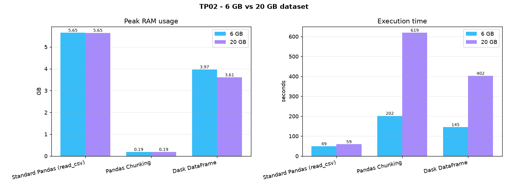

# TP02 — How to Work with Big Data Files (+5GB)

**Module:** Big Data Analytics — Master 2 IA & Data Science — 2026/2027
**University of Eloued** — Faculty of Exact Sciences — Computer Science Dept.

Read a **5 GB+ file** three ways and compare them, on **two dataset sizes
(6 GB and 20 GB)**:

1. **standard Pandas `read_csv()`** → runs out of memory (OOM),
2. **Pandas chunking** → stream the file with constant memory,
3. **Dask DataFrame** → parallel + lazy computing.

---

## Contents

```
TP2_big_data_files/
├── generate_dataset.py     # creates the CSVs (data/*.csv)
├── tp02.py                 # the 3 tasks + report + charts
├── compare.py              # 6 GB vs 20 GB comparison
├── requirements.txt        # pandas dask[complete] psutil matplotlib pyarrow
├── report/
│   ├── comparison.png      # 6 GB vs 20 GB
│   ├── comparison.html
│   ├── 6gb/                # benchmark.png, memory_timeline.png, report.html, results.*
│   └── 20gb/
└── data/                   # the big CSVs (NOT committed - see below)
```

## Datasets

Generated **sales** CSVs with mixed types (numeric + strings):

| File | Size | Rows |
|------|-----:|-----:|
| `data/sales_6gb.csv` | 6.02 GB | 75,000,000 |
| `data/sales_20gb.csv` | 20.07 GB | 248,000,000 |

Columns: `order_id, order_date, customer_id, product, category, region,
payment_method, quantity, unit_price, total_amount`.

**Why generated:** a real 5 GB+ **CSV** is not practical to download here
(available sources run at ~0.5–1.9 MB/s → 1–5 hours, and the fast ones are
Parquet, which breaks the `pd.read_csv()` task). Generating is instant,
reproducible (seeded), and gives the exact size and schema needed.

```bash
python generate_dataset.py --gb 6  --name sales_6gb.csv
python generate_dataset.py --gb 20 --name sales_20gb.csv
```

---

## Setup & run

```bash
pip install -r requirements.txt
python generate_dataset.py --gb 6 --name sales_6gb.csv

python tp02.py --data data/sales_6gb.csv  --report report/6gb
python tp02.py --data data/sales_20gb.csv --report report/20gb
python compare.py
```

---

## The three tasks

| # | Task | Function | What happens |
|---|------|----------|--------------|
| 1 | **The Traditional Failure (OOM)** | `task1_oom()` | `pd.read_csv()` loads the *whole* file into RAM and crashes with `MemoryError` |
| 2 | **Stream Processing (Chunking)** | `task2_chunking()` | reads the file in chunks of **100,000 rows** and accumulates `sum` / `mean` incrementally |
| 3 | **Parallel Out-of-Core (Dask)** | `task3_dask()` | `dask.dataframe.read_csv` builds a **lazy** graph; `.compute()` runs it in parallel |

Extra pieces: `MemoryMonitor` (samples RAM over time with `psutil`),
`build_report()` (charts with `matplotlib`) and `compare.py`.

### About Task 1 on a big-RAM machine
This machine has 32 GB RAM + an automatic page file, so a naive `read_csv()`
would eventually finish (very slowly) instead of crashing. To reproduce the
real-world failure **deterministically**, Task 1 runs the read in a subprocess
whose memory is capped with a **Windows Job Object** (`TASK1_MEMORY_LIMIT_GB = 6`).
When the process passes the cap, the allocation fails → `MemoryError`.

---

## Results — 6 GB

| Method | Status | Peak RAM | Execution time |
|--------|--------|---------:|---------------:|
| Standard Pandas (`read_csv`) | **MemoryError (OOM)** | 5.65 GB | 48.9 s |
| Pandas Chunking | OK (constant memory) | **0.19 GB** | 201.8 s |
| Dask DataFrame | OK (parallel) | 3.97 GB | **144.8 s** |



## Results — 20 GB

| Method | Status | Peak RAM | Execution time |
|--------|--------|---------:|---------------:|
| Standard Pandas (`read_csv`) | **MemoryError (OOM)** | 5.65 GB | 59.3 s |
| Pandas Chunking | OK (constant memory) | **0.19 GB** | 618.7 s |
| Dask DataFrame | OK (parallel) | 3.61 GB | **402.5 s** |



## 6 GB vs 20 GB

| Method | Peak 6 GB | Peak 20 GB | Time 6 GB | Time 20 GB | Time ×|
|--------|----------:|-----------:|----------:|-----------:|------:|
| Standard Pandas | 5.65 GB | 5.65 GB | 48.9 s | 59.3 s | ×1.21 |
| Pandas Chunking | 0.19 GB | 0.19 GB | 201.8 s | 618.7 s | ×3.07 |
| Dask DataFrame | 3.97 GB | 3.61 GB | 144.8 s | 402.5 s | ×2.78 |



### What the numbers show
* **RAM stays constant while the data grows ×3.3** — chunking 0.19 GB and Dask
  ~3.6–4 GB are the same for 6 GB and 20 GB. Only **time** grows with the size.
* **Standard Pandas always dies** (OOM) no matter the size — the failure is
  about loading everything at once, not about the file size.
* **Dask is faster than chunking** (≈1.4× here) because it uses several threads
  and an optimized graph, while chunking is sequential.
* Both safe methods computed **identical results** on each dataset
  (e.g. 20 GB: `sum(total_amount) = 1,708,391,574,126.21`).

---

## GitHub note

**The datasets are NOT uploaded.** GitHub rejects files over **100 MB**
(free Git LFS is only 1 GB), so `data/` is in `.gitignore`. Only the scripts,
the README and the small `report/` files are committed. To get the data, run
`generate_dataset.py`.
